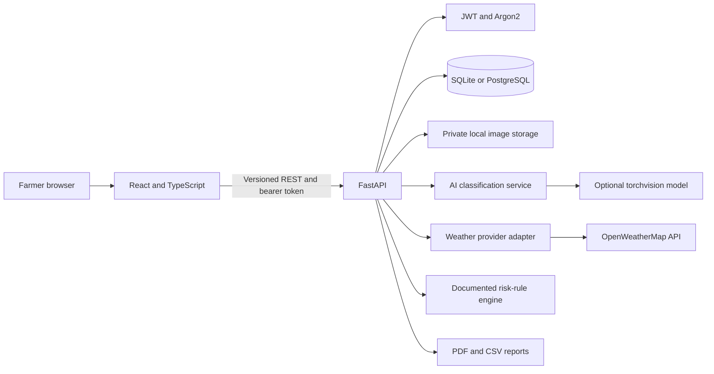
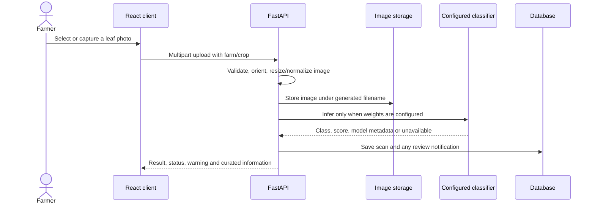

# FarmShield AI

### Detect Today, Healthier Crops Tomorrow.

FarmShield AI is a farmer-friendly crop health decision-support prototype. It keeps farm observations and scans in one private workspace, supports tomato leaf image classification when compatible weights are configured, and separates provider-sourced weather facts from any explicitly documented risk rule.

> **Honest AI by design:** no model weights are bundled. Without a configured model, a scan is saved without a prediction and the interface says **“AI model unavailable — demo mode is active.”** Weather is not fabricated when an API key is missing. Educational information is not a diagnosis or treatment recommendation.

## Problem and approach

Crop symptoms can be difficult to interpret, while scattered records and weather context make it harder to decide what to inspect next. FarmShield provides a small, explainable workflow to record a farm, capture a leaf, preserve its scan history, and consult sourced educational guidance. It supports farmers and expert conversations; it does not replace agricultural expertise.

## Features

- Email/password registration, Argon2 password hashing, expiring JWTs, and per-user authorization.
- Farm CRUD, coordinates, crop association, and private scan records.
- JPEG/PNG/WEBP validation, EXIF orientation, size/dimension checks, basic image-quality warnings, upload preview, and browser camera capture.
- Optional startup-loaded PyTorch/torchvision ResNet-18 or MobileNetV3-Small inference with configurable labels and an uncertainty threshold.
- Tomato disease reference seeded from educational summaries with sources, symptoms, prevention, and safe next steps.
- Optional OpenWeatherMap current conditions and forecast; no fabricated observations.
- Empty-by-default, file-configurable, source-required risk rules. Without a validated rule, the app makes no weather-related disease claim.
- Database-backed dashboard and analytics, scan filters/pagination, private image retrieval, PDF scan reports, and CSV export.
- English, Hindi, and Marathi navigation/overview labels; responsive layouts and keyboard-visible focus states.
- Alembic initial migration, SQLite development database, PostgreSQL driver compatibility, Docker Compose, tests, and GitHub Actions.

## Screenshots

Add authentic project screenshots here after running the app (do not use mock screenshots as evidence of model capability).

| Dashboard | Scanner | Weather and risk center |
| --- | --- | --- |
| `docs/screenshots/dashboard.png` (not captured yet) | `docs/screenshots/scanner.png` (not captured yet) | `docs/screenshots/weather.png` (not captured yet) |

## Architecture





## Technology

| Layer | Stack |
| --- | --- |
| Frontend | React 18, Vite, TypeScript strict, Tailwind CSS, React Router, Recharts, Lucide, Axios, React Hook Form, Zod |
| Backend | Python, FastAPI, Pydantic Settings, SQLAlchemy, Alembic |
| Data | SQLite by default; PostgreSQL via psycopg |
| AI | Optional PyTorch + torchvision; configurable ResNet-18 or MobileNetV3-Small checkpoint |
| Weather | OpenWeatherMap adapter with in-process cache; optional API key |
| Quality | Pytest, Vitest, React Testing Library, ESLint, TypeScript build, GitHub Actions |

## Workflow and data model

Images are validated before processing, EXIF orientation is applied, and a normalized JPEG is stored outside the database. A configured model produces a class probability distribution; low top-class scores are flagged for expert verification. No model produces no class. The dashboard and analytics query stored user-owned records and show useful empty states.

The relational model includes `User`, `Farm`, `Crop`, `Scan`, `Disease`, `Advisory`, `WeatherRecord`, `RiskAlert`, `Notification`, and `UserPreference`. See [`docs/architecture.md`](docs/architecture.md) and [`docs/database.md`](docs/database.md).

## Windows PowerShell setup (without Docker)

Prerequisites: Python 3.11+ and Node.js 20.19+ or 22.12+; Windows PowerShell. The optional PyTorch packages have their own platform/Python compatibility matrix. No Docker installation is required for local SQLite use.

### 1. Create and configure the backend

Open a PowerShell terminal at the repository root:

```powershell
py -3 -m venv backend\.venv
.\backend\.venv\Scripts\Activate.ps1
python -m pip install --upgrade pip
python -m pip install -r backend\requirements.txt
Copy-Item backend\.env.example backend\.env
```

Edit `backend\.env`. The defaults run with a local SQLite file; change `SECRET_KEY` for any shared environment. Run the migration and start the API from the backend folder:

```powershell
Set-Location backend
alembic upgrade head
uvicorn app.main:app --reload
```

The API is at <http://127.0.0.1:8000>, interactive OpenAPI docs at <http://127.0.0.1:8000/docs>, and health check at <http://127.0.0.1:8000/api/health>. Startup creates SQLite tables for convenient development; Alembic is the schema upgrade workflow.

### 2. Configure the frontend

In a **second** PowerShell terminal at the repository root:

```powershell
Set-Location frontend
Copy-Item .env.example .env
npm.cmd install
npm.cmd run dev
```

Open the Vite URL (normally <http://localhost:5173>). `VITE_API_URL` defaults to `http://127.0.0.1:8000`. Create an account from the app. The token is held in browser `sessionStorage` until the tab session ends; this is convenient for a student demo but remains exposed to JavaScript, so production should use an HttpOnly cookie and CSRF protection.

### 3. Optional integrations

- **Weather:** add an OpenWeatherMap API key to `OPENWEATHER_API_KEY` in `backend\.env`. Add a farm with latitude/longitude. Without a key, the UI reports that live weather is not configured and does not show sample observations.
- **AI:** install optional dependencies, obtain/train a compatible checkpoint, and configure `MODEL_PATH`, `MODEL_ARCH`, `MODEL_LABELS_PATH`, and `MODEL_VERSION`. Follow [`docs/ai-model.md`](docs/ai-model.md). No weights or private dataset are included.
- **Demo farm seed:** from `backend`, set a local-only password and run `python scripts\seed_demo.py`. The seed creates one clearly named demo user and farm, but no fabricated scan or prediction.
- **Risk rules:** [`backend/app/data/weather_risk_rules.json`](backend/app/data/weather_risk_rules.json) starts empty. Consult [`docs/weather-rules.md`](docs/weather-rules.md); do not use the schema example thresholds as validated thresholds.

## Commands and tests

From the repository root:

```powershell
# Backend checks (with backend\.venv activated)
Set-Location backend
python -m pytest

# In another terminal, frontend checks
Set-Location frontend
npm.cmd test
npm.cmd run lint
npm.cmd run build
```

`npm.cmd run build` performs strict TypeScript project builds before producing `frontend\dist`. Backend API docs are generated from FastAPI schemas. See [`docs/api.md`](docs/api.md) for endpoint groups and pagination/filter behavior.

## Configuration

| Variable | Purpose | Default |
| --- | --- | --- |
| `DATABASE_URL` | SQLAlchemy database URL | `sqlite:///./farmshield.db` |
| `SECRET_KEY` | JWT signing key; 32+ characters required in production | development-only |
| `ACCESS_TOKEN_MINUTES` | Bearer token lifetime | `60` |
| `CORS_ORIGINS` | Comma-separated allowed origins | `http://localhost:5173` |
| `MAX_UPLOAD_MB` | Image upload limit | `8` |
| `UPLOAD_DIR` | Private local image directory | `uploads` |
| `MODEL_PATH` | Local checkpoint path (empty disables inference) | empty |
| `MODEL_LABELS_PATH` | JSON list of ordered class labels | tomato sample mapping |
| `MODEL_ARCH`, `MODEL_VERSION` | Classifier architecture and display version | `resnet18`, `custom-plantvillage` |
| `CONFIDENCE_THRESHOLD` | Marks lower top-class scores uncertain | `0.65` |
| `RISK_RULES_PATH` | JSON rules with source/rationale | empty rule file |
| `OPENWEATHER_API_KEY` | Server-only weather provider key | empty |

Do not place secrets in the frontend `.env`; Vite variables are public in built assets.

## Docker (optional)

Docker Compose starts PostgreSQL and the API; the frontend remains separately run with Vite or can be deployed as static assets:

```powershell
docker compose up --build
```

The compose credentials are local-development placeholders and must not be reused in a deployment. For local SQLite, follow the non-Docker steps above.

## Security, known limitations, and future work

FarmShield is a student prototype, not a validated diagnostic product. No pretrained weight file is bundled or certified; the default project can record scans but cannot classify until a compatible checkpoint is supplied. Tomato disease notes are educational summaries. Risk rules are disabled by default. Weather forecast and camera operation require a configured provider and browser permission respectively. Profile editing, password reset, offline/PWA support, Grad-CAM, and public deployment hardening are not implemented. See [`docs/security.md`](docs/security.md).

Future work could add evaluated field-image models, expert-reviewed region-specific advisories, object storage, background inference jobs, password recovery, localized disease/safety content, and privacy-reviewed offline features.

## Publish to GitHub

Create an empty repository on GitHub (do not initialize it with a README, license, or `.gitignore`), then run these commands from the project root in PowerShell. Replace `<YOUR_USERNAME>` with your GitHub username:

```powershell
git init
git add .
git status
git commit -m "Build FarmShield AI agricultural health platform"
git branch -M main
git remote add origin https://github.com/<YOUR_USERNAME>/farmshield-ai.git
git push -u origin main
```

The `.gitignore` excludes environment files, local databases, uploaded images, model weights, and generated frontend files. Review `git status` before committing and confirm no credentials or private data are staged.

## Team

- **Student/team:** [Add names and roles]
- **Faculty mentor:** [Add name, if applicable]

## License and acknowledgements

Released under the [MIT License](LICENSE). The optional sample class names are PlantVillage-style labels; no dataset or model weights are included. If using PlantVillage images or a derivative model, follow the applicable dataset/model license and cite Hughes & Salathé, arXiv:1511.08060. Disease-library entries link their educational source context to the University of California Statewide IPM Program; see the source text on each entry. OpenWeatherMap is an optional third-party service subject to its terms.
