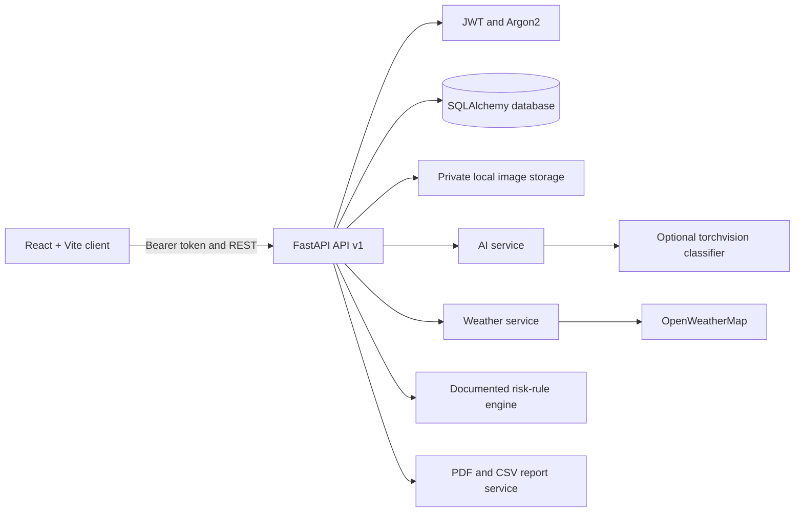

# Architecture

FarmShield is a small monorepo organized around explicit service boundaries. The React client never receives model or weather credentials. The API resolves each authenticated account from a signed, expiring bearer token and scopes private database queries to that account.

## Request lifecycle

1. The browser validates form state, file type and client-side size, then sends a multipart image request.
2. The API enforces media type and configured byte limits, validates decoded image format and dimensions, rotates EXIF orientation, and stores a normalized JPEG under a random server-generated name.
3. The startup-loaded classifier either returns a real configured model output, an uncertainty flag, or a clearly labeled unavailable/error state. Missing weights never create a disease class.
4. The API looks up curated educational information by exact class label and saves scan metadata; file bytes remain outside the database.
5. All private resource reads and mutations use the authenticated owner ID, never a frontend-supplied user ID.

Weather observations are provider data with timestamps and source labels. The risk engine only evaluates explicit JSON rules and otherwise returns no disease-risk claim. Model softmax scores are not presented as real-world accuracy and are never treated as disease severity.
